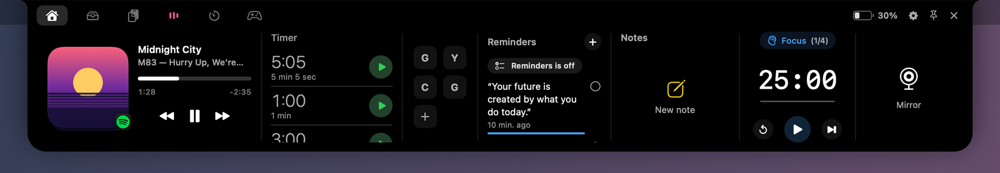
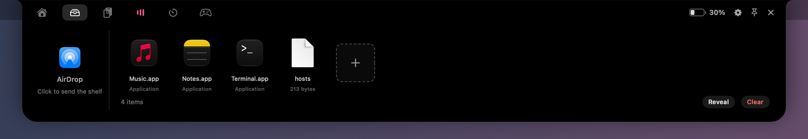
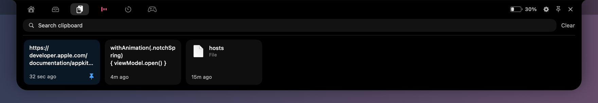
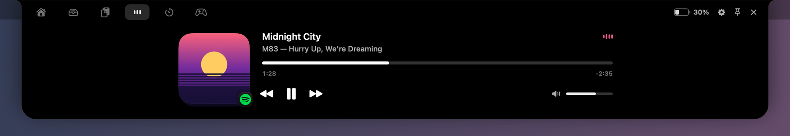
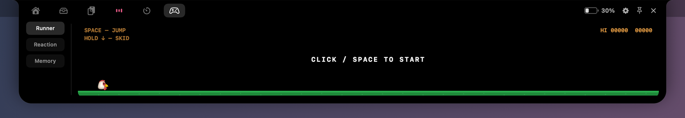
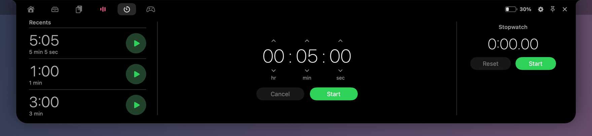
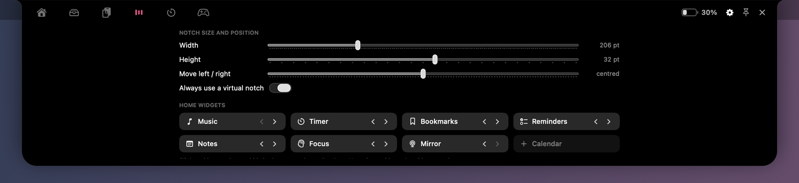

<div align="center">

# NeoNotch

**A notch companion for macOS.**
Music, timers, a file shelf, clipboard history, widgets and games, all in a black island at the top of your screen.


[](LICENSE)



</div>

## Features

- **Home dashboard.** Music, Timer, Bookmarks, Reminders, Notes, Focus, Mirror and Calendar widgets side by side. Show, hide and reorder them; the panel is exactly as wide as the widgets you keep.
- **Shelf.** Drop files on the notch to park them, then drag them back out anywhere. A built-in AirDrop target sends whatever you drop on it.
- **Clipboard history.** Text, images and files you copy, as a searchable row of cards. Pin what you want to keep. Items marked concealed by password managers are never captured.
- **Now playing.** Spotify and Apple Music with cover art, a drag-to-seek scrubber, transport and volume. The closed notch shows the cover and level bars tinted with the album's colour.
- **Timers and stopwatch.** A layout modelled on Apple's Clock app, with recents and laps. Timers and the stopwatch running in Clock show up here too.
- **Focus.** A Pomodoro timer with short and long breaks, notifications and a daily streak.
- **Games.** A side-scrolling runner, a reaction test and a memory game, sized for the notch.
- **On-device AI.** On Macs with Apple Intelligence (macOS 26+), rephrase or summarise clipboard text and notes, and get a daily brief of your calendar. Nothing leaves your Mac.
- **Works on every Mac.** On a Mac without a notch, NeoNotch draws a virtual one that blends into the menu bar. On a notched display it fits the real cutout exactly.
- **Free and open.** No account, no trial, no telemetry.

## Screenshots

| Shelf | Clipboard |
| :---: | :---: |
|  |  |
| **Music** | **Play** |
|  |  |
| **Timer** | **Settings** |
|  |  |

When it is closed, the island only grows sideways, so it never covers the window you are working in:

| Playing | Timer | Focus | Charging |
| :---: | :---: | :---: | :---: |
|  |  |  |  |

## Requirements

- macOS 14 Sonoma or later. The Apple Intelligence features need macOS 26 on a supported Mac; without it, their buttons don't appear.
- Xcode 26 or later to build.

## Installation

There is no prebuilt download yet, so build it from source:

```bash
git clone https://github.com/praneeth-icecube/neonotch.git
cd neonotch
open NeoNotch.xcodeproj
```

Press **⌘R** to run. To build a Release copy, install it into `/Applications` and launch it in one step:

```bash
Scripts/install.sh
```

<details>
<summary><b>Keeping permissions across rebuilds (optional)</b></summary>

macOS remembers permissions (Calendar, Reminders, camera, Automation) per code signature. Builds are signed ad-hoc by default, and an ad-hoc signature changes on every build, so macOS asks again after each rebuild.

`Scripts/install.sh` avoids this when it finds a signing identity called **NeoNotch Local Signing** in a keychain at `Signing/NeoNotch.keychain-db` (password `neonotch`). `Signing/` is git-ignored, so the identity never leaves your machine. To set one up:

1. Create the keychain: `security create-keychain -p neonotch Signing/NeoNotch.keychain-db`
2. In Keychain Access, choose **File → Add Keychain…** and add that file.
3. Choose **Keychain Access → Certificate Assistant → Create a Certificate…**. Name it `NeoNotch Local Signing`, set Identity Type to *Self Signed Root* and Certificate Type to *Code Signing*, and tick *Let me override defaults* so you can pick the NeoNotch keychain as its location.

Without it, the script still works and signs the build ad-hoc.

</details>

## Usage

NeoNotch runs as a menu bar agent: it has no Dock icon and no windows of its own. Its menu bar icon has **Open Notch**, **Settings…** and **Quit**.

- **Hover** over the notch to open the panel, and move away to close it. Click the pin to keep it open.
- Press **⌃⌥N** to open or close it from the keyboard. ⌃⌥⌘N and ⌥⌘\ are available in Settings.
- **Drag a file** toward the notch and it opens straight onto the Shelf.
- Open **Settings** (the gear in the panel) to change the notch's size and position, choose Home widgets, set Focus lengths and clipboard rules, and more.

### Apple Clock

Timers and the stopwatch you start in Clock appear in NeoNotch automatically. Clock has no API for other apps to control it, so NeoNotch drives Clock through Shortcuts you create once. Make a shortcut with a single Clock action and name it after that action, prefixed with `NeoNotch`:

`NeoNotch Start Timer` · `NeoNotch Pause Timer` · `NeoNotch Resume Timer` · `NeoNotch Cancel Timer` · `NeoNotch Start Stopwatch` · `NeoNotch Stop Stopwatch` · `NeoNotch Reset Stopwatch`

In **NeoNotch Start Timer**, set the duration to *Shortcut Input* (in minutes). Every shortcut is optional, and **Settings → Apple Clock** shows which ones were found.

## Permissions

Apart from notifications, NeoNotch asks for each permission only when you first use the feature that needs it.

| Permission | Asked when | Used for |
| --- | --- | --- |
| Automation | Spotify or Apple Music is first seen running | Playback controls, volume and cover art. Seeing what's playing works without it. |
| Calendar | You press **Allow** in the Calendar widget | Showing the day's events (read-only) |
| Reminders | You turn on **Sync with Reminders** in Notes | Two-way sync between Notes and Reminders |
| Camera | You open the Mirror | The camera mirror, which stops as soon as it leaves the screen |
| Notifications | First launch | Alerts when a timer or focus session ends, including on the lock screen |

NeoNotch doesn't need Accessibility access: its keyboard shortcut uses the system hot key API. It isn't sandboxed, so the Shelf can point at files wherever they live.

## Privacy

- No accounts, analytics or telemetry.
- Notes, bookmarks, focus history and clipboard history are stored as JSON in `~/Library/Application Support/NeoNotch`.
- The only network requests are album art lookups (Spotify's oEmbed endpoint and the iTunes Search API) and bookmark icons, which are fetched from the bookmarked sites themselves, never from a third-party favicon service.
- Apple Intelligence runs entirely on-device.

## Development

```
NeoNotch/
├── App/        Entry point, settings, snapshot renderer and self-tests
├── Core/       View model, notch geometry, preferences, storage, hot key
├── Features/   One folder per feature: Music, Timer, Shelf, Clipboard, Home…
├── UI/         Notch shape, theme, closed and open views
└── Window/     The click-through NSPanel and its controller
Scripts/        install.sh
docs/           Architecture notes and images
```

The app binary has a few switches for development:

| Command | What it does |
| --- | --- |
| `NeoNotch --snapshot <dir>` | Renders every panel state to PNGs with sample data. No screen recording permission needed. |
| `NeoNotch --selftest-widgets` | Checks the widget logic (Pomodoro cycle, streaks, bookmark parsing, note drafts) in a throwaway folder |
| `NeoNotch --selftest-music [--offline]` | Compiles every AppleScript against the real Spotify and Music dictionaries, and tests cover lookups |
| `NeoNotch --selftest-drop <file>` | Exercises the Shelf's drop handling with Finder-shaped pasteboards |
| `NEONOTCH_TRACE=1 NeoNotch` | Logs pointer, hit-test, clipboard and Apple Event activity |

The binary is at `NeoNotch.app/Contents/MacOS/NeoNotch`. Run the music self-test through `open -a NeoNotch.app --args --selftest-music`, so macOS credits the Automation permission to NeoNotch rather than to your terminal.

To learn how it works, from the click-through window to the Apple Clock bridge, read [docs/ARCHITECTURE.md](docs/ARCHITECTURE.md).

## Contributing

Issues and pull requests are welcome. See [CONTRIBUTING.md](CONTRIBUTING.md) to get started.

## License

NeoNotch is released under the [MIT License](LICENSE).
